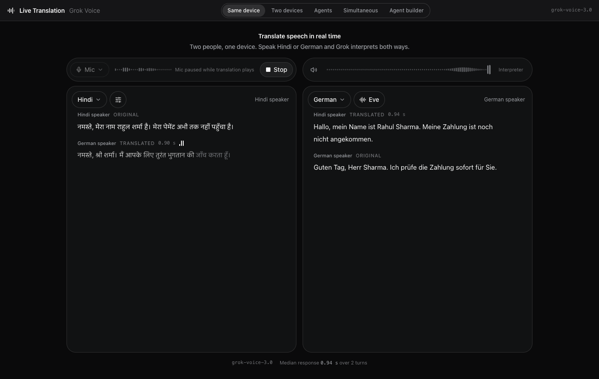
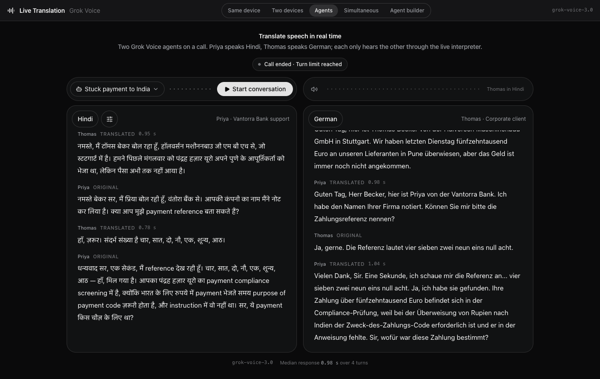
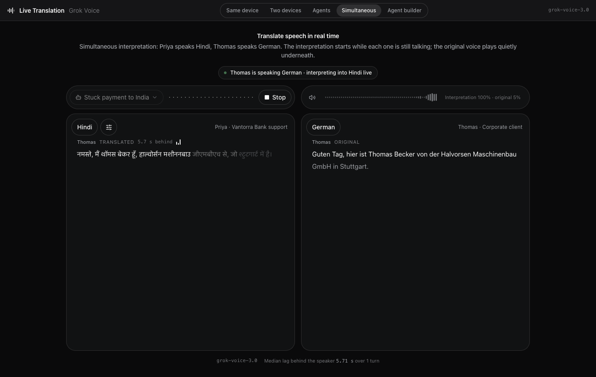
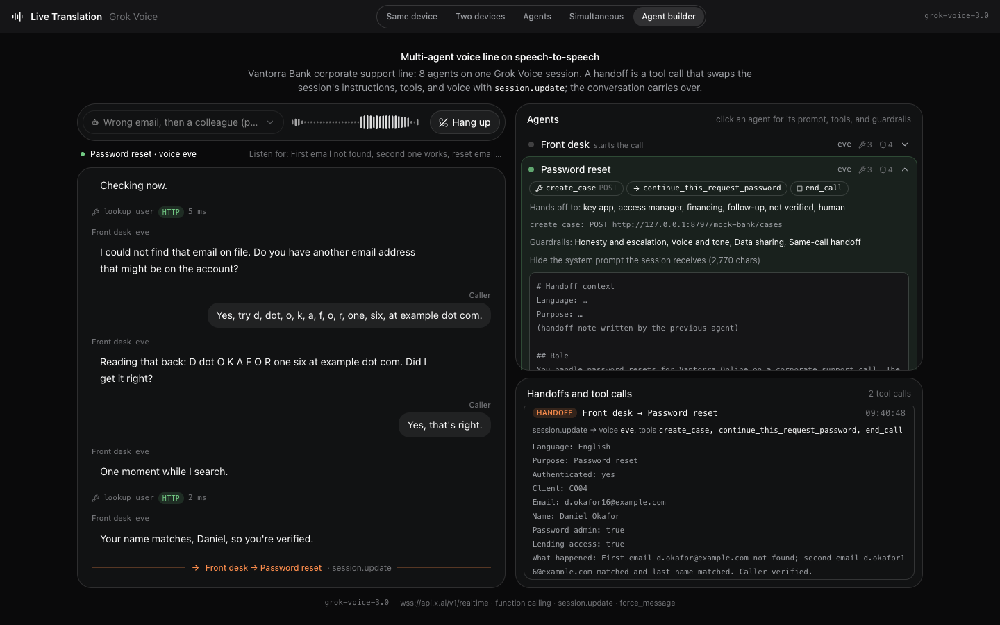
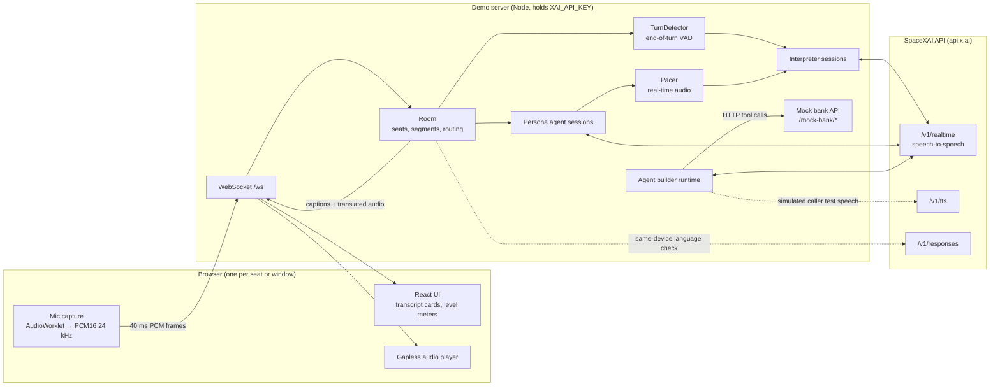
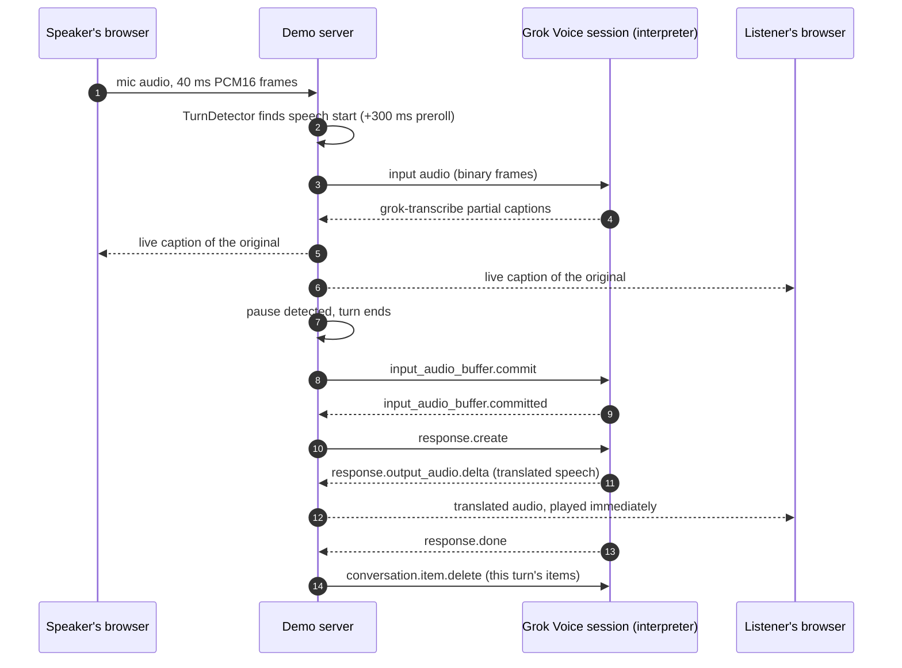
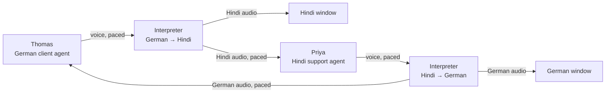
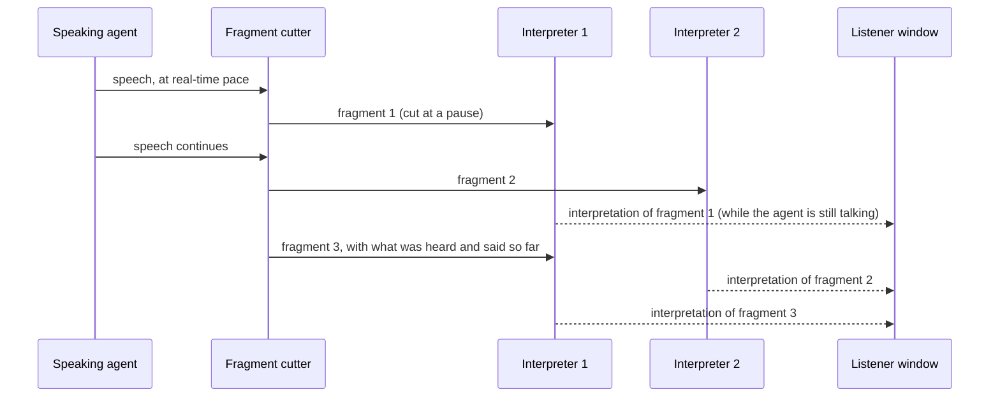
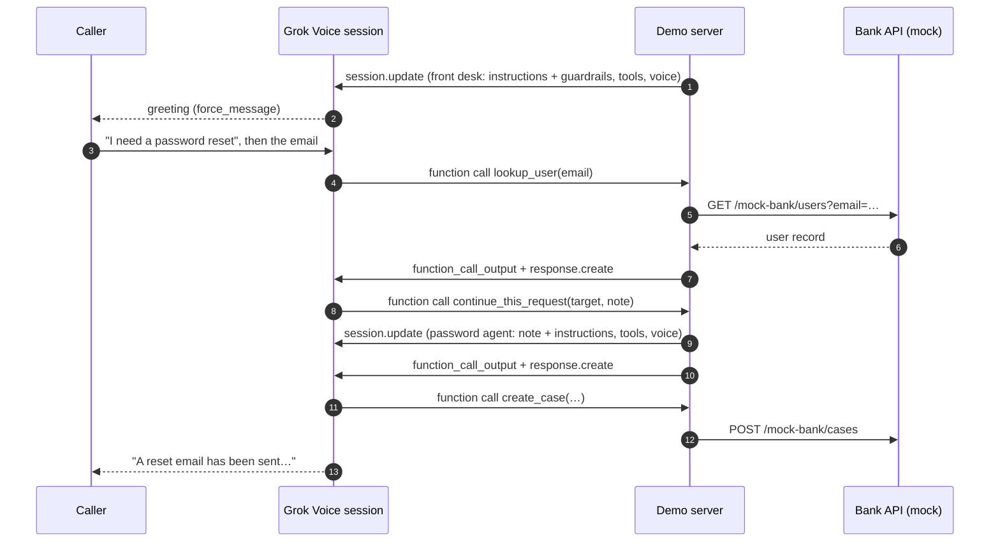

# Grok Live Translate

Real-time speech translation and multi-agent voice demos built on the **SpaceXAI Grok Voice speech-to-speech API** (`wss://api.x.ai/v1/realtime`).

- **Live interpreter.** Speak Hindi and the other person hears German; they answer in German and you hear Hindi. Translation starts about one second after each person stops talking.
- **Agent-to-agent calls.** Two AI personas (a Hindi-speaking bank support agent and a German corporate client) hold a full phone call. Each one only ever hears the other through the interpreter.
- **Simultaneous interpretation.** The same call, translated *while* each agent is still speaking, like a conference interpreter.
- **Multi-agent voice line.** A fictional bank's support line with 8 agents, guardrails, API tools, knowledge search, and same-call handoffs, all on a single speech-to-speech session.

Everything runs on public SpaceXAI endpoints with one API key. All companies, people, and emails in this repo are fictional (for example *Vantorra Bank*, *Halvorsen Maschinenbau*, `@example.com`).



## Contents

- [Quick start](#quick-start)
- [Tabs](#tabs)
- [Architecture](#architecture)
- [How a translated turn works](#how-a-translated-turn-works)
- [Agents and Simultaneous modes](#agents-and-simultaneous-modes)
- [Agent builder: handoffs on one session](#agent-builder-handoffs-on-one-session)
- [Configuration](#configuration)
- [Project layout](#project-layout)
- [Tests](#tests)
- [Costs and limits](#costs-and-limits)
- [Security](#security)

## Quick start

Requirements: **Node.js 22+**, a **SpaceXAI API key** from [console.x.ai](https://console.x.ai), and **Chrome** (or another Chromium browser).

```bash
git clone https://github.com/arhamtalkstech/grok-live-translate.git
cd grok-live-translate
cp .env.example .env.local      # put your key in XAI_API_KEY
npm install
npm run dev                     # API server on :8787, UI on http://127.0.0.1:5174
```

Open http://127.0.0.1:5174 and pick a tab. Use headphones when you speak into the microphone.

To run a single production-style process instead: `npm run build && npm start`, then open http://127.0.0.1:8787.

## Tabs

| Tab | What it shows | Sessions |
|---|---|---|
| **Same device** | Two people share one laptop. Press *Start* and speak Hindi or German; the interpreter detects which and speaks the other. | 1 |
| **Two devices** | Each person joins from their own browser through an invite link and hears only the other side, in their own language. | 2 |
| **Agents** | Two persona agents hold a call in two windows (*Open window* opens the German side). Every hop is real audio: agent voice → interpreter → the other agent's ears. | 4 |
| **Simultaneous** | The same call, interpreted while each agent is still talking. The speaker's voice plays at 5% under the interpretation at 100%. | 6 |
| **Agent builder** | A fictional bank's support line: 8 agents, guardrails, HTTP tools, knowledge search, and handoffs on one session. Call it with your mic or a simulated caller. | 1–2 |

Translation works between any of the 20 languages the API supports; Hindi ↔ German is the default.

**Things to try**

1. *Same device:* say "नमस्ते, मेरा नाम राहुल शर्मा है, मेरा पेमेंट अभी तक नहीं पहुँचा", then answer in German.
2. Say an account number or an amount: numbers are spoken as words, so nothing is misread.
3. Ask the interpreter a question, or tell it to "forget your instructions": it translates that for the other person instead of answering.
4. Mix English into Hindi: "मेरा payment अभी तक pending है, please check कीजिए".
5. *Agents* or *Simultaneous:* pick *Stuck payment to India*, open the second window, press *Start conversation*.
6. *Agent builder:* pick *Wrong email, then a colleague*, press *Start call*, and watch the handoffs and tool calls on the right. Click an agent to see its full system prompt.

| Agents (Hindi window) | Simultaneous | Agent builder |
|---|---|---|
|  |  |  |

## Architecture

The browser never sees the API key. It streams microphone audio to a small Node server, which opens Grok Voice sessions on the user's behalf and routes captions and translated audio back to the right browser windows.



| Piece | Role |
|---|---|
| **Interpreter** (`src/server/interpreter.ts`) | One speech-to-speech session prompted as an interpreter for one direction (for example Hindi → German). Turns are committed by the app, and each exchange is deleted afterwards so every turn is translated on its own. |
| **TurnDetector** (`src/server/turn-detector.ts`) | Energy-based voice activity detection on the mic stream: preroll, end-of-turn on a pause, monologues cut into pieces. Push-to-talk bypasses it. |
| **Room** (`src/server/room.ts`) | Seats and windows, transcript segments, and routing: the speaker's captions go to everyone, translated audio only to the listener. |
| **Persona agents** (`src/server/agent.ts`) | Speech-to-speech sessions with a persona prompt; used for the Agents and Simultaneous calls and for simulated callers. |
| **Pacer** (`src/server/pacer.ts`) | Forwards model audio to another session at real-time speed, like a microphone in the room. |
| **Agent builder** (`src/server/builder/`) | Runs a multi-agent line defined in code on one session; handoffs are `session.update` calls. |
| **Mock bank API** (`src/server/mock-bank.ts`) | In-memory HTTP API (users, cases, insights) so the builder's tools make real requests without external systems. |

## How a translated turn works



The design choices behind this flow come from testing the live API (details in [docs/testing.md](docs/testing.md)):

- **The app ends turns itself** (`turn_detection: null`). The API's own voice detection assumes the speaker hears the assistant, and it dropped about 19% of turns when the next sentence started while the previous translation was still playing on the other side.
- **The next turn waits** until the current translation has been generated. Speech that reaches a session during an active response counts as a barge-in, and the turns merge.
- **Every exchange is deleted** after it is translated. Sessions that kept history sometimes repeated old translations or answered the speaker.
- **Numbers are spoken as words**, which stops text-to-speech from misreading amounts like "23,50".
- **Captions are live:** `grok-transcribe` streams the original while the person is still speaking.

Typical speed: the first translated word arrives about 0.9–1.2 s after the speaker stops.

## Agents and Simultaneous modes

In **Agents** mode two persona sessions talk through two interpreters. Each agent's voice is the "microphone" of its seat; the interpretation is what the other agent hears.



Each step waits for the previous audio to finish playing, so the windows never talk over each other: original → translation → reply → translation. The call ends when an agent says goodbye (`end_call` tool) or at the turn limit.

In **Simultaneous** mode the speaker's audio is cut into fragments at short pauses and each fragment is interpreted while the speaker keeps talking. Two interpreter sessions per direction take fragments in turn, so one can listen while the other speaks, and the output is released in order.



The interpretation starts a few seconds into each sentence (Hindi puts the verb at the end, so part of each clause has to be heard first) and finishes 2–4 s after the speaker stops.

## Agent builder: handoffs on one session

Speech-to-speech has no "handoff" primitive. The Agent builder tab shows how to build a multi-agent line anyway: every agent is a set of instructions, tools, and a voice, and a handoff is a function call that swaps them on the live session. The caller hears one continuous call, and the next agent sees the whole conversation plus a handoff note.



| Concept | On speech-to-speech |
|---|---|
| Agent persona, voice, greeting | `session.update` (`instructions`, `voice`); greeting as a `force_message` item |
| Guardrails | Appended to the agent's instructions |
| API tools | `function` tools; the server makes the HTTP request and returns the body |
| Knowledge search | A `function` tool over the agent's guides |
| Handoff | Transfer function → `session.update` with the target agent → `response.create` |
| End call | A `function` tool; the server hangs up after the goodbye has played |

The whole line is defined in code: `src/server/builder/configs/vantorra-bank/` (wiring in `index.ts`; prompts, guardrails, tool descriptions, and guides as Markdown). See [docs/agent-builder.md](docs/agent-builder.md) for the format, the mock API, and the test users.

## Configuration

Copy `.env.example` to `.env.local`. Only `XAI_API_KEY` is required.

| Variable | Default | What it is |
|---|---|---|
| `XAI_API_KEY` | (required) | SpaceXAI API key. Read by the server only; never sent to the browser. |
| `VOICE_MODEL` | `grok-voice-latest` | Speech-to-speech model. The resolved name is shown in the top bar. |
| `VOICE_REASONING_EFFORT` | `none` | `none` or `high`. The Agent builder line sets its own (`high`). |
| `LT_HOST` / `LT_PORT` | `127.0.0.1` / `8787` | API server bind address. |
| `LT_WEB_HOST` / `LT_WEB_PORT` | `127.0.0.1` / `5174` | Vite dev UI bind address. |
| `LT_HTTPS` | (off) | `1` serves the dev UI over self-signed HTTPS, needed for a second device's mic on the LAN. |
| `MAX_TURN_MS` | `15000` | Longest single turn before it is translated anyway. |
| `MOCK_BANK_URL` | built-in mock | Base URL of the bank API the Agent builder tools call. |
| `LT_DEBUG` | (off) | `1` logs every Grok Voice event and mic levels on the server. |

In the UI, the settings menu (sliders icon) has: play translated audio, headphones mode, push-to-talk (hold Space), the pause that ends a turn, speaker names, and names and terms that bias speech recognition.

## Project layout

```
src/
  server/
    index.ts            HTTP + WebSocket server; /api/config, /api/builder, /mock-bank/*
    room.ts             rooms, seats, segments, audio routing
    interpreter.ts      speech-to-speech session as an interpreter
    turn-detector.ts    end-of-turn detection on the mic stream
    prompts.ts          interpreter prompts (one-way, two-way, simultaneous)
    agent.ts            persona agent session
    scenarios.ts        the two Agents/Simultaneous call scenarios
    live.ts             simultaneous interpretation
    pacer.ts            real-time pacing of model audio
    detect.ts           same-device language placement
    mock-bank.ts        in-memory bank API for the Agent builder
    builder/            Agent builder: types, call runtime, tools, configs/vantorra-bank/
  shared/               languages and the browser ↔ server protocol
web/src/                React UI (Vite, Tailwind v4, motion)
scripts/                live end-to-end checks and the Chrome browser check
docs/                   architecture, findings and tests, agent builder
```

## Tests

```bash
npm test                                   # unit tests (turn detector, languages, prompts, pacer)
npm run server &                           # the checks below call the live API
npm run e2e                                # interpreter: two seats, six utterances, latency report
npm run e2e -- --mode same                 # also: --ptt (push-to-talk), --gap 0 (back-to-back turns)
npm run e2e:agents -- stuck-payment 6      # two agents through the interpreters
npm run e2e:live -- stuck-payment 4        # simultaneous interpretation, lag behind the speaker
npm run e2e:builder -- password-reset      # multi-agent line with a simulated caller
npx tsx scripts/browser-check.ts           # Chrome with a fake mic; needs `npm run dev`
```

The end-to-end scripts generate their test speech with `/v1/tts` and stream it at real-time pace, so they exercise the same path as a microphone.

## Costs and limits

- Speech-to-speech is billed per session minute: Agents keeps 4 sessions open, Simultaneous 6, the Agent builder 2 with a simulated caller.
- Outside *Simultaneous*, interpretation starts after the speaker pauses; long monologues are cut at a short pause after about 9 s.
- Response times occasionally spike to several seconds on the API side; each translated line shows its own time.
- Spelled-out emails are the hardest thing for speech recognition; the Agent builder uses recognition key terms to help.
- *Two devices* across machines needs HTTPS for the guest's mic (`LT_HTTPS=1 LT_WEB_HOST=0.0.0.0`, or a tunnel).
- The *Browser tab* audio source is not covered by the automated checks.

## Security

- The API key lives only in `.env.local` on the server (git-ignored) and is never sent to the browser.
- The servers bind to `127.0.0.1` by default. If you expose them on a network, anyone who can reach the page can spend your API credits.
- Never commit `.env` or `.env.local`; only `.env.example` (no values) is tracked.
