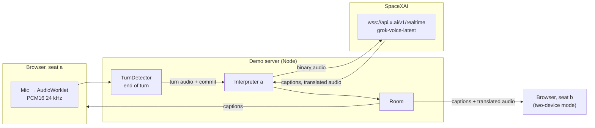
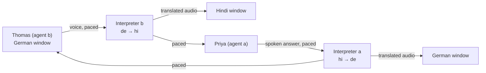

# How it works

## Modes

| Mode | Sessions | Who hears what |
|---|---|---|
| Same device | One session with a two-way prompt ("if you hear Hindi, speak German; if you hear German, speak Hindi"). | Everything plays on the one device. The server puts each turn in the right column by script (Devanagari vs Latin), or with a short `grok-4.3` call when both languages use the same script. |
| Two devices | One one-way session per seat (Hindi→German for seat a, German→Hindi for seat b), each with `language_hint`. | Each seat receives only the other seat's translated audio. Captions go to both. |
| Agents | Four sessions: a persona agent per seat (`agent.ts`) and the same one-way interpreter per seat. | Each window plays its own agent's voice and the translation of the other agent. |
| Simultaneous | Six sessions: the two agents and two simultaneous interpreters per direction (`live.ts`). | Like Agents: each window plays its own agent's voice (5%) and the interpretation of the other (100%); a single window plays everything. |

## Agents mode

- Agents are Grok Voice sessions with a persona prompt (`scenarios.ts`) and `turn_detection: null`. They keep their history; the interpreters stay stateless.
- The starter opens with `force_message` (the scripted line, spoken verbatim) or a normal response when the opening is empty.
- An agent's output audio is the "microphone" of its seat: it is fed to that seat's interpreter. The interpreter's translated audio is fed to the other agent as its input, then committed, and the agent answers.
- Each hop waits for the previous audio to finish playing, so the two windows never talk over each other: original → translation → reply → translation.
- Both agents have an `end_call` tool; the call stops after the goodbye has been translated, or at the turn limit.
- Agent sessions cancel any response they did not request, so only one agent talks at a time.

## Real-time pacing

Model audio arrives about 4× faster than real time, but the Realtime API consumes input audio at real-time speed. Forwarding it in a burst made the following commit wait until the API had caught up: a commit took 6.7 s to be acknowledged, and some translations started 10–22 s late. `Pacer` forwards 40 ms frames on a real-time clock, exactly like a microphone in the room, and the commit is sent when the pacer drains. Commits are now acknowledged in about 110 ms.

## Languages are pinned

Every interpreter session gets `audio.input.transcription.language_hint` for the language it hears (`hi` or `de`) and a prompt that names the exact direction ("Hindi speaker … always speak German"). Agent sessions pin the language they hear too (Priya `hi`, Thomas `de`). The only exception is *Same device*: one session hears both people on one mic, so it cannot pin a single input language; its prompt still names only the two room languages. Run with `LT_DEBUG=1` to see the input config each session accepted.

## A turn, step by step

1. The browser captures the mic with echo cancellation and noise suppression, resamples to 24 kHz PCM16 in an AudioWorklet, and sends 40 ms binary frames over `/ws`.
2. `TurnDetector` tracks the noise floor and opens a turn after 80 ms of speech, including 300 ms of preroll so the first syllable is kept. A pause (default 650 ms, adjustable) ends the turn. After about 9 s of continuous speech a 320 ms pause also ends it, so monologues are translated in pieces. Push-to-talk skips the detector.
3. `Interpreter` streams the turn's audio to the session as binary frames (`audio.input.transport: "binary"`). `grok-transcribe` returns cumulative captions about every second, so the original appears while the person is speaking.
4. At the end of the turn the app sends `input_audio_buffer.commit` and, after `input_audio_buffer.committed`, `response.create`.
5. Translated audio (`response.output_audio.delta`) and its transcript stream back. The room forwards the audio to the listener and patches the segment, recording the response time (commit to first audio).
6. On `response.done` the turn's user item and assistant items are deleted (`conversation.item.delete`), so every turn is translated on its own.

## Why turns are handled this way

All of these come from tests against the live API (see `testing.md`):

- **App-side turn detection (`turn_detection: null`).** With the API's server VAD, about 19% of turns were dropped when the next sentence started while the previous translation was still playing, because the API assumes the speaker hears its output.
- **Holding audio while a translation is generated.** Even with `turn_detection: null`, speech that reaches the session during an active response is treated as a barge-in, and the turns merge. `Interpreter` keeps the next turn's audio and commit in a local queue and sends them right after `response.done`. Generation runs about 4× faster than real time, so the wait is short.
- **Deleting each exchange.** Sessions that kept history sometimes re-spoke the end of the previous translation, or answered the speaker instead of translating.
- **Numbers as words.** Hindi text-to-speech read "23,50 यूरो" as 23,050. The prompt asks for all numbers, amounts, and digits as words in the output language.
- **Mic pause on speakers.** Without headphones the browser sends silence while a translation plays, so the interpreter never translates its own voice.

## Files

- `src/server/interpreter.ts`: session config, the send queue, item cleanup, a 45 s watchdog for a response that never finishes.
- `src/server/room.ts`: seats, segments (`listening → translating → speaking → done`), audio routing, language placement in same-device mode.
- `src/server/turn-detector.ts`: the energy VAD.
- `src/server/prompts.ts`: interpreter rules shared by both prompts.
- `web/src/lib/use-room.ts`: socket, reconnect, playback, mic gating.
- `web/src/lib/audio.ts`: AudioWorklet capture and gapless playback with per-segment timing (used to mark the line that is playing).

## Simultaneous mode

The agents call, interpreted while each agent is still talking (`src/server/live.ts`).

1. The speaking agent's audio is paced like a live mic. A turn detector tuned for fragments cuts it at short pauses: after 1.5 s of speech a 200 ms pause ends a fragment, 300 ms always does, 7 s at the latest. Slivers under 450 ms are dropped.
2. Each fragment is committed to an interpreter as soon as it ends, while the agent keeps speaking. The response carries per-fragment context (`fragmentContext`): what was heard so far and what was already said, so fragments join into one utterance without repeats or guessed sentence endings.
3. Two interpreter sessions per direction take fragments in turn. With one session the next fragment had to wait for the previous answer and then reach the API in a burst; since the API reads input in real time, the lag grew by about a second per fragment. Translated audio is released strictly in fragment order.
4. The left card shows the source as live `grok-transcribe` captions of the fed audio, so the Hindi appears as it is spoken. The right card fills with the interpretation.
5. The listener agent hears the interpretation at real-time pace and replies once the last fragment has played.
6. Audio routing: the speaker's own window plays their voice, and the listener's window plays the interpretation. With only one window open, it gets both. The browser plays the original on its own player at 5% and the interpretation on another at 100%, so they overlap. Each interpreted line records `lagMs`: speaker start → first interpreted audio.

## Agent builder tab

A multi-agent support line for a fictional bank on one speech-to-speech session: a handoff is a function call that swaps the session's instructions, tools, and voice with `session.update`. See [agent-builder.md](agent-builder.md).
